<h1 align="center">
  <picture>
    <source media="(prefers-color-scheme: dark)" srcset="apps/web/public/logo-dark.svg">
    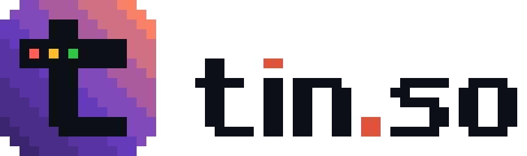
  </picture>
</h1>

<p align="center"><strong>Beautiful code images. For humans and agents.</strong></p>

<p align="center">
  <a href="https://tin.so">Web editor</a> ·
  <a href="#cli">CLI</a> ·
  <a href="#agent-skill">Agent skill</a> ·
  <a href="#the-spec">Spec</a>
</p>

<p align="center">
  <a href="https://www.npmjs.com/package/tin.so"></a>
  <a href="LICENSE"></a>
</p>

<p align="center">
  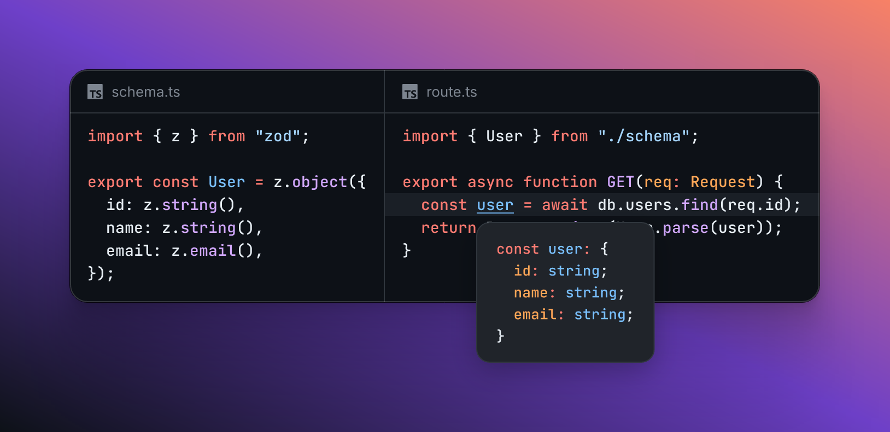
</p>

tin.so makes images of code that show more than one snippet: split panes, stacked windows and popovers that point to a word. Highlight lines, give any part of the code a style or a color, and pick one of 14 editor themes and a background. People use the [web editor](https://tin.so), and agents use the [CLI](#cli) and the [agent skill](#agent-skill). Both use the same renderer, so they make the same image without a server or a browser.

## Web editor

<p align="center">
  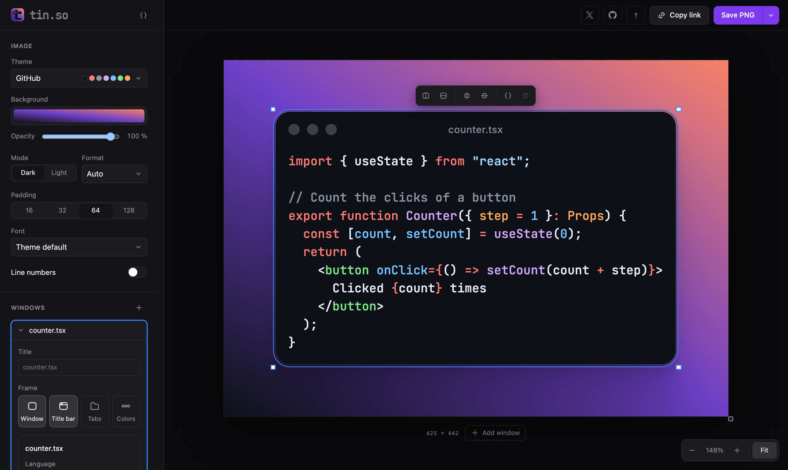
</p>

Open [tin.so](https://tin.so), type or paste your code into the window, and save a PNG or SVG. You need no account, and your code stays in your browser: the image renders on your computer, and a shared link keeps the image in the URL fragment, which never goes to a server.

## Features

### Several snippets in one image

<p align="center">
  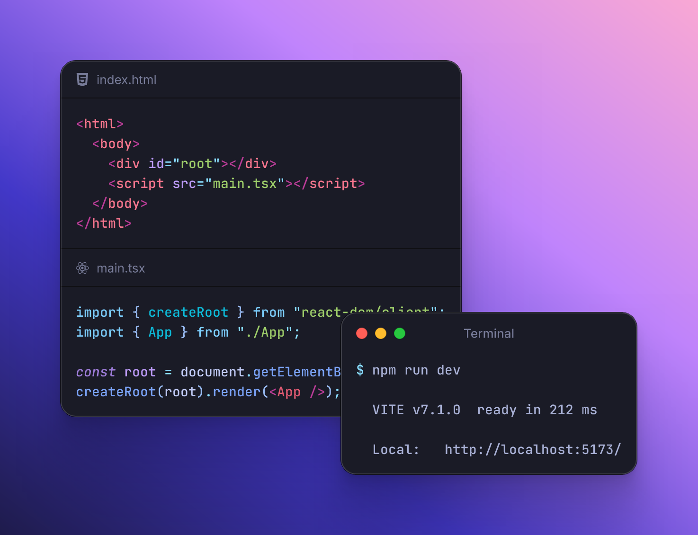
</p>

An image can show more than one file. Split a window into panes, put several windows below each other or side by side, or place windows freely and let them overlap.

- Split a window into panes, side by side or below each other.
- Stack several windows in one image, below each other or side by side.
- Put windows anywhere in a free layout, and let them overlap. The image grows when a window gets larger. Reset the layout to go back to padding and direction.
- Add panes to the right or below, and remove a pane with its × button in the image.
- Add, duplicate (⌘D) and remove windows.
- Resize the whole image at its right edge, its bottom edge or its corner. With an aspect ratio, the image keeps the ratio. Double-click a handle to fit the image to the windows again.

### Arrange windows

- Move windows with the mouse. Drag one of the selected windows to move all of them. A moved or resized window snaps, and guide lines show, when it aligns with the center of the image or with the edges and centers of other windows.
- Resize a window at its edges and corners, panes at the divider between them, and a popover at its corner. Double-click to fit them to the code again.
- Select several windows with a box, with Shift-click or with ⌘A. Align them in 6 ways, distribute them (3 or more), copy their image or remove them, from the toolbar above them or their right-click menu.
- The toolbar above one selected window adds a pane to the right or below, centers, formats or removes the window. In the free layout with 2 or more windows, it also brings the window to the front or sends it to the back.
- Right-click a window to duplicate it, fit it to the code, reset its position, center it, change its layer, format its code, copy its image or remove it. Right-click the background to add a window, select all windows, reset the layout or copy the image.
- In the free layout, change the order of overlapping windows as in Figma: bring forward (⌘]), bring to front (⌘⇧]), send backward (⌘[) and send to back (⌘⇧[).
- Copy and paste windows with ⌘C and ⌘V, also from one browser tab to another. The clipboard gets the windows as spec JSON, and a paste of any spec JSON with windows adds them.
- The window list in the sidebar outlines a window in the image when you point to it. Shift-click or ⌘-click selects several windows.
- Sidebar notices have a one-click fix: the free layout has a Reset button, and a window or pane with a fixed size has a Fit button.
- Zoom in and out, fit the image to the screen, or show it at 100%. The image size shows below the image.

### Popovers

<p align="center">
  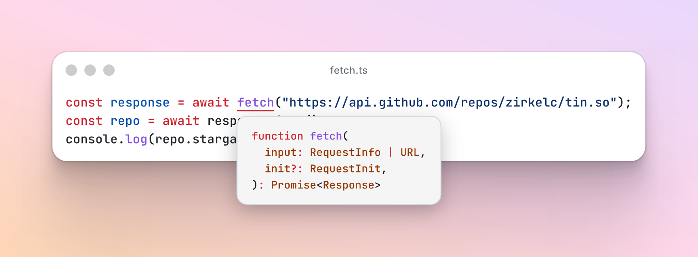
</p>

A popover points to a word in the code and looks like the hover card of an editor. Use it to show a type, a signature or a value next to the code that uses it.

- A popover has its own code and language. It is a little lighter than its window in dark mode and darker in light mode, so it stands out from the code below it.
- Select a word in one line, right-click and choose "Add popover". The popover starts with the selected word as its code.
- The window card in the sidebar lists the popovers of each pane, with their word and line. A click on a row selects the popover and shows its settings below the row, the pointer on a row highlights the popover in the image, and a row marks a popover whose word is no longer in the code.
- Click a popover to select it. Its right-click menu and the sidebar reset, fit or remove it, the sidebar sets its language, and ⌫ removes it.
- Move a popover, and resize it at its corner. Double-click it to put it back below its word.
- A notice shows popovers whose word is no longer in the code, with a Remove button.

### Highlights, styles and colors

<p align="center">
  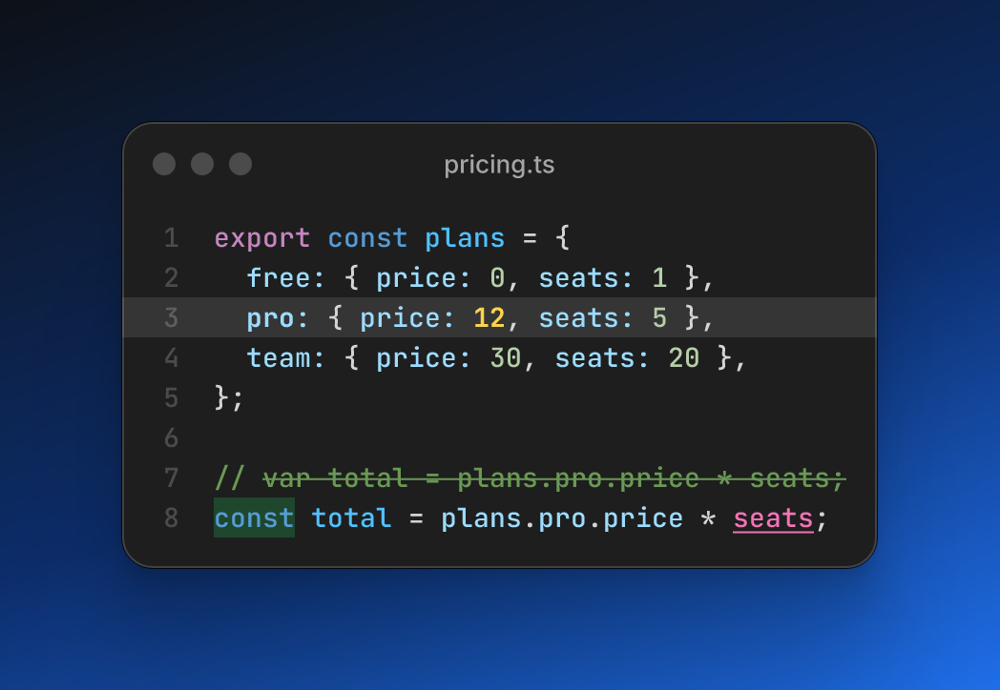
</p>

Show the reader where to look. Highlight full lines, or give any part of a line a style, a text color or a fill.

- Highlight lines and ranges of lines. Option-click a line to highlight it, as in ray.so, or right-click the code.
- Bold, italic, underline and strikethrough on any part of a line, in the code and in popovers. Select code and right-click "Clear styles" to remove its styles, colors and fills.
- A text color and a fill on any part of a line, in the code and in popovers, from a palette of 16 colors in the editor, or any hex color with or without alpha in a spec. The fill is translucent, as a highlighter, so the code stays readable.
- Select code or popover code in the image to open a panel above the selection with the text colors, the fills and the styles. "None" removes a text color or a fill, "Clear" removes all styles and colors of the selection, and the panel shows the current colors and styles.
- Highlights, styles and popovers stay on their lines when you add or remove lines above them, also when several lines have the same text. Deleting a line removes its highlight and styles, also in popover code, and its popovers move to the line of the edit.
- Line numbers in all panes with one switch in the Image section, or per pane with the switch of the pane, which overrides the image. The switch of the image resets all panes.

### Themes

<p align="center">
  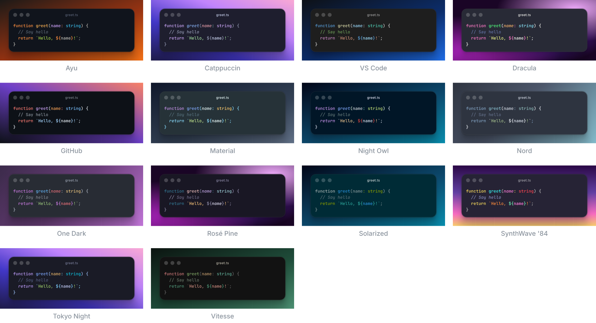
</p>

- 14 themes of code editors: Ayu, Catppuccin, Dracula, GitHub, Material, Night Owl, Nord, One Dark, Rosé Pine, Solarized, SynthWave '84, Tokyo Night, Vitesse and VS Code. The code has the exact colors of the original theme, and the window has its background. Most themes have a dark and a light variant (for example Catppuccin Mocha and Latte), and the mode switch selects one.
- The theme list shows a small preview of each theme and has a search field. Move the mouse over a theme, a background or a font, or use the arrow keys, to see it on the image at once. A click or Enter keeps it, and Escape goes back.
- 9 code fonts: JetBrains Mono, Geist Mono, IBM Plex Mono, Fira Code, Roboto Mono, Commit Mono, Space Mono, Source Code Pro and Google Sans Code.

### Backgrounds

<p align="center">
  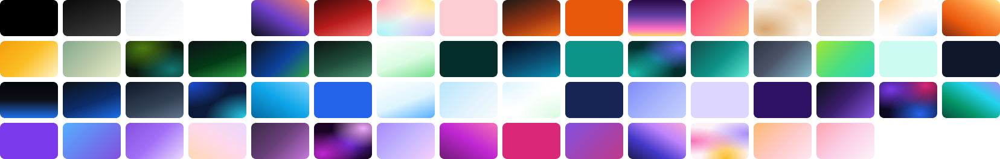
</p>

- Each theme gives the image its own background for each mode, such as a gradient from dark to blue for VS Code dark and a soft peach and blue mesh for VS Code light. A new theme resets the background to its own and keeps the opacity.
- The Background field below the theme shows the background as a bar with an opacity slider under it (0 % is a transparent image).
- The bar opens a panel with three tabs:
  - **Gradient:** a field with the CSS of the gradient, and tiles of the gradient and mesh presets.
  - **Color:** tiles of solid color presets.
  - **Custom:** a color picker with a saturation and brightness square, a hue slider, an eyedropper where the browser has one, and R, G and B fields.
- Each tile shows the preset with a small window of the theme on it and its name under it. The 62 presets are in order of color: grays first, then by hue, and from dark to light within a hue.
- A spec or the CLI can use any color or CSS gradient: `linear-gradient` and `radial-gradient`, in several layers with a color as the last layer.
- Padding around the windows: 16, 32, 64 or 128 px in the editor (Auto in the free layout), from 0 to 256 px in a spec.

### Sizes for social media

<p align="center">
  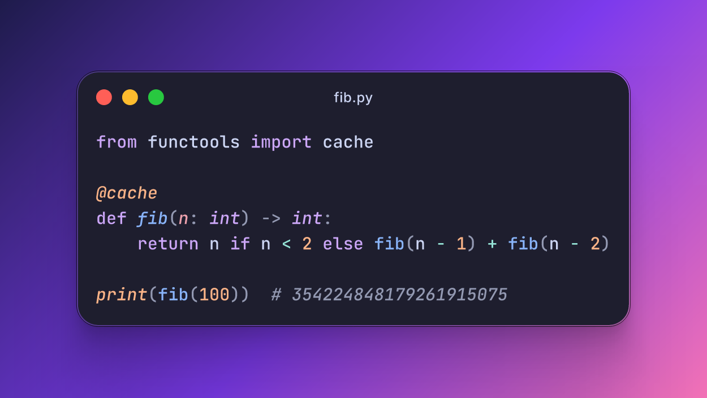
</p>

- Aspect ratio presets in the editor: 16:9 (X post, YouTube), 1.91:1 (Open Graph, LinkedIn), 1:1, 4:5 (Instagram), 9:16 (Story, Reels, TikTok), 4:3 (slides), 3:2 and 2:1.
- Any aspect ratio from 1:10 to 10:1 in a spec, alone or with a width or a height. The windows stay in the center.

### Windows

<p align="center">
  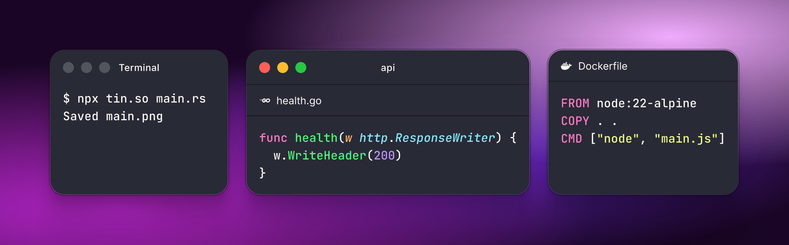
</p>

- A title bar with the window controls and a title, or no title bar.
- Gray window controls, or red, yellow and green as in macOS. Click the controls in the image to switch.
- A tab above each pane, with the icon of the language and the file name.
- An icon per tab: the icon of the language, a file icon, no icon, or any icon from the list. Click a tab icon in the image to pick another icon from a list with search.
- No window: the code goes directly on the background.
- Turn the window, the title bar, the tabs and the control colors on and off with the toggle buttons in the Frame row.
- Edit the window title and the file names of the tabs directly in the image.

### Code

<p align="center">
  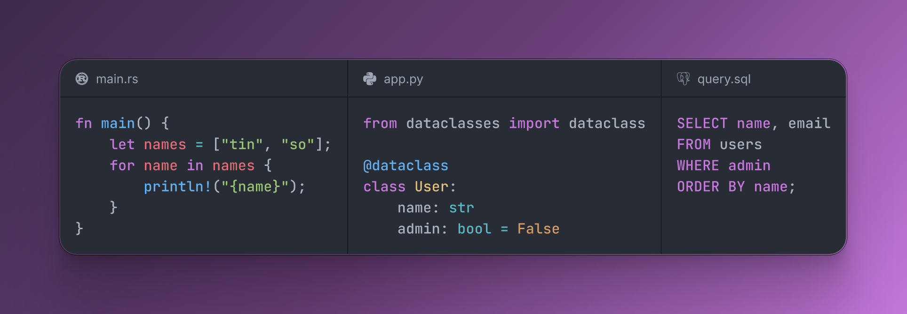
</p>

- Type the code directly in the image.
- Syntax highlighting with Shiki, for all Shiki languages.
- The language comes from the file name ("Auto (TypeScript)"), also for extensions such as `.ex`, `.sol`, `.ml` and `.service`, or you select it.
- A short example for each of the 242 languages. When you pick a language for a pane that has no code or still has an example, the pane gets the example of that language with a typical file name, such as `main.py` or `Dockerfile`. Code that you wrote stays.
- A new page opens with a React counter in the GitHub theme.
- Format the code with Prettier, for JavaScript, TypeScript, JSON, CSS, HTML, Markdown, YAML and more. The line width follows the aspect ratio of the image.
- Tab inserts two spaces in the code, in a popover and in the JSON editor.
- Edit the full spec as JSON, with syntax colors and each problem shown while you type.

### Export

- Save a PNG or an SVG, or copy the image to the clipboard.
- PNG at 1x, 2x or 4x. The editor keeps your last export option.
- The saved file takes its name from the first pane, for example `main.png`.
- Copy an image of only one window or of the selected windows.
- The SVG contains the fonts, so it shows the same everywhere.
- The PNG and the SVG contain an editor link that holds the full spec, "tin.so" as the software and the editor URL as the source. The image stores the spec only once, in the link, so the metadata adds less than 1 KB. The "Embed the spec" switch in the export menu turns this off.
- Drop an exported PNG or SVG into the editor to edit the image again, with all its windows, code and settings.
- The image renders on your computer, with no server and no browser screenshot. The web editor and the CLI make the same image.

### Share

- Copy a link that opens the same image in the editor.
- The link contains the full image in the URL fragment, so it never goes to a server.
- The address bar always holds the current image, so a reload or a bookmark keeps it.
- Short messages confirm a copied image, window or link, and tell you when a copy, an export or a dropped file fails. A link with an invalid spec opens the default image with a message.

### Keyboard shortcuts

| Keys             | Action                                                                                      |
| ---------------- | ------------------------------------------------------------------------------------------- |
| ⌘B, ⌘I, ⌘U, ⌘⇧X  | Bold, italic, underline, strikethrough                                                      |
| ⇧⌥F              | Format the code                                                                             |
| ⌥-click          | Highlight a line                                                                            |
| ⌘A, Esc          | Select all windows, clear the selection                                                     |
| ⌘D               | Duplicate the selected window                                                               |
| ⌘C, ⌘V           | Copy and paste windows                                                                      |
| ⌘], ⌘⇧], ⌘[, ⌘⇧[ | Bring the selected window forward or to front, or send it backward or to back (free layout) |
| ⌫                | Remove the selected windows or popover                                                      |
| ?                | Open the about dialog with all shortcuts                                                    |

The ? button in the toolbar opens the same dialog. It also shows the commands for the CLI and the agent skill, and links to the privacy notice and the legal notice.

## CLI

The `tin` CLI renders code files, code on stdin or a JSON spec to a PNG or SVG on your machine, with no browser and no account. Every image comes with a link that opens the same image in the web editor, so a person can change it by hand.

```bash
npx tin.so main.ts        # run it without an installation
npm install -g tin.so     # or install the tin command
```

It needs Node 22.18 or later.

```bash
# One file
tin main.ts

# Two files side by side in one window, with tabs
tin schema.ts route.ts --tabs --no-title-bar -o api.png

# Each file in its own window, with a theme
tin worker.ts main.ts --windows --theme tokyo-night

# Code from the clipboard, copied back as an image
pbpaste | tin --title main.ts --copy

# An image for a post on X
tin main.ts --aspect-ratio 16:9 --background "linear-gradient(135deg, #1e1b4b, #f472b6)"

# A spec, for popovers, highlights and styles
tin spec.json

# Only the editor link, opened in the browser
tin link main.ts --open
```

| Command                | What it does                                                                                   |
| ---------------------- | ---------------------------------------------------------------------------------------------- |
| `tin [render] <input>` | Renders code files, code from stdin or a spec to a PNG or SVG. `render` is the default command |
| `tin link <input>`     | Prints the editor link without an image. `--copy` copies it, `--open` opens it in the browser  |
| `tin themes`           | Lists the themes                                                                               |
| `tin languages`        | Lists the languages                                                                            |
| `tin fonts`            | Lists the fonts                                                                                |
| `tin schema`           | Prints the JSON Schema of the spec                                                             |
| `tin skill`            | Shows how to add the agent skill. `--print` prints the skill itself                            |

The [CLI README](packages/cli/README.md) lists all options.

### Input

- Rendering is the default command: `tin main.ts` is `tin render main.ts`, and options can come before the files (`tin --theme dracula main.ts`).
- Render several files in one command: one pane per file, or one window per file with `--windows`.
- Pipe plain code to the CLI: `pbpaste | tin --title main.ts --copy`. `--title` gives the language and the file name, and `--language` sets the language. JSON on stdin without a title becomes a JSON image. `--code 'x = 1'` gives the code as text.
- A spec on stdin starts with `"$schema"` (the URL of `tin schema`), which tells the CLI that it is a spec and not code. A `.json` file is a spec when it has this `"$schema"` or a `windows` array. `--spec` and `--no-spec` turn off the detection.

### Look

- Options set the theme, mode, font, padding, background (a color, `#from,#to` or a CSS gradient), background opacity (0 to 1), line numbers, direction and aspect ratio, also over the fields of a spec.
- The window options (tabs, title bar, frame, controls and split) are for code files and `--code`.

### Output

- Set the output file (`-o`), the format (`-f png|svg`, or from the file extension) and the PNG scale (`-s`, default 2). The default output never replaces an input file. The CLI stops and asks for `-o`.
- Copy the image to the clipboard with `--copy` (macOS, Linux and Windows), with or without a file.
- The CLI prints the saved file, its size and a link that opens the image in the web editor. With `--json` it prints this as JSON.
- `--no-metadata` writes no spec into the image file.
- `tin link` prints an editor link for a spec, files or code on stdin, and makes no image. `tin link main.ts --open` opens the link in the browser, and `--copy` copies the link.
- `TIN_APP_URL` sets the web editor of the links.

### Help and errors

- Help per command (`tin link --help`) with only the options of that command. `tin --help` shows the options of rendering first, then the commands.
- An unknown option is an error that names the closest option (`Unknown option --them for render, did you mean --theme?`), and an unknown theme or font names the closest one. Fixed choices such as `--format png|svg` and `--mode dark|light` reject other values.
- An invalid spec gives an error that lists every issue with its path, such as unknown fields, missing fields, unknown languages, and images larger than 8192 px.
- The CLI lists the themes, languages and fonts, and prints the JSON Schema of the spec.

## Agent skill

The [tin skill](skills/tin/SKILL.md) shows coding agents such as Claude Code, Codex and Cursor how to use the CLI. With the skill, you can ask your agent for "an image of this function for X" or "the schema and the route side by side, with the type of `user` as a popover", and the agent writes the command or the spec, renders the image and gives you the file and the editor link.

```bash
npx skills add zirkelc/tin.so
```

### Agents in a browser

The web editor has a versioned API on `window.tin` for agents that drive a browser instead of the CLI: read and set a spec, wait until the first image is ready, and export an image, with or without the spec in the file.

```js
await window.tin.ready;
await window.tin.setSpec(spec); // rejects with the issues of an invalid spec
const { dataUrl, width, height } = await window.tin.export({ format: "png", scale: 2 });
```

## The spec

A spec is JSON that describes the whole image: its windows, the panes of each window, and the code of each pane with its highlights, styles and popovers. The web editor, the CLI, the links and the image files all use the same spec. This spec makes the image at the top of this README, without the code of `schema.ts`:

```json
{
  "$schema": "https://tin.so/schema/v1.json",
  "windows": [
    {
      "tabs": true,
      "titleBar": false,
      "panes": [
        { "title": "schema.ts", "code": "import { z } from \"zod\";\n…" },
        {
          "title": "route.ts",
          "code": "import { User } from \"./schema\";\n…",
          "highlight": [4],
          "annotations": [{ "line": 4, "match": "user", "code": "const user: {\n  id: string;\n…" }]
        }
      ]
    }
  ]
}
```

- [`packages/core/src/spec.ts`](packages/core/src/spec.ts) defines the spec with valibot. Its JSON Schema is on the site at `https://tin.so/schema/v1.json`, and `tin schema` prints it. A spec file with `"$schema"` gets checks and completion in editors such as VS Code.
- The spec is versioned (`"v": 1`, or the version in the `$schema` URL, such as `/schema/v1.json`). Links and image files carry the version, so they keep working when the spec changes. Old links and images without a version still open, and a spec from a newer version gives the error "Update tin.so". A `v` that does not agree with the `$schema` URL is an error.
- A link carries the spec in the URL fragment (`#spec=<deflate + base64url>`), so it never goes to a server.
- Keys that start with `x-` hold data of other tools in any object of a spec. The renderer ignores them, so they never make a spec invalid.
- Unknown fields and unknown theme, font or icon ids are errors that say to check the name or to update tin.so, so a typo or a newer spec does not give a wrong image.
- Limits keep images safe to render: 50 windows, 20 panes per window, 100,000 characters of code per pane or popover, 200 popovers, 200 marks (styles and colors) and 1,000 highlight entries per pane, titles up to 200 characters, and sides up to 8192 px.

The [spec reference of the skill](skills/tin/references/spec.md) explains every field with examples.

## Development

### Packages

| Path            | What                                                                                                    |
| --------------- | ------------------------------------------------------------------------------------------------------- |
| `packages/core` | The renderer: `spec → Shiki tokens → layout → SVG → PNG (resvg-wasm)`. Runs in Node and in the browser. |
| `packages/cli`  | The `tin` CLI: renders code files or a JSON spec to PNG or SVG, and prints an editor link.              |
| `apps/web`      | The web editor (Vite + React), deployed to Cloudflare as static assets.                                 |
| `skills/tin`    | The agent skill for the CLI.                                                                            |

### Setup

```bash
pnpm install
pnpm dev        # builds the packages, then starts the web editor on http://localhost:5173
pnpm ready      # check, build and test everything
pnpm run deploy # deploy the web editor to Cloudflare
```

The browser tests of the web editor run in headless Chromium with Vitest browser mode. A new machine needs the browser once: `pnpm --filter @tin.so/web exec playwright install chromium`.

The links of the CLI open the hosted editor. To open the local editor instead, set `TIN_APP_URL=http://localhost:5173/`. The GitHub links of the site come from `VITE_GITHUB_URL` (see `apps/web/.env.example`).

The example images of this README are specs in `apps/web/scripts/generate-readme-images.ts`. Run `pnpm --filter @tin.so/web generate-readme-images` after a change to the renderer, the themes or the backgrounds. The social image, the app icons and the logo of this README come from `generate-og-image`, and the theme previews of the theme list from `generate-theme-previews`. The screenshot of the editor (`docs/images/editor.png`) is a manual screenshot at 1440 × 860 px with a pixel ratio of 2.

The site loads no analytics script. The visitor counts come from the analytics of the tin.so zone in Cloudflare, which count the requests on the server. The privacy notice is `apps/web/privacy.html`. Change it when the site starts to send data to a new service.

## License

[MIT](LICENSE). The window style comes from [ray.so](https://github.com/raycast/ray-so) (MIT), the editor themes from their projects, most of them through Shiki (MIT or Apache 2.0), the file icon from Lucide (ISC), the language icons from Simple Icons (CC0), and the fonts are under the SIL Open Font License, except Commit Mono (MIT). See [`packages/core/THIRD_PARTY_NOTICES.md`](packages/core/THIRD_PARTY_NOTICES.md).

<!--
TODO (not shown on GitHub)

- Raycast extension: make a code image from the selected text or the clipboard, with the CLI or the core package.
- VS Code extension: make a code image of the selected code, with the file name and the language of the editor.
- PWA: install the web editor as an app, with offline use and the share target for code and images.
- Hidden watermark: a weak pattern in the pixels of a PNG that marks it as made with tin.so (about 32 bits: a marker and a version, no user or image ID). Phase 1 survives JPEG at the same size (8×8 DCT blocks, repeated bits, a `tin detect` command and a check on drop in the editor), about 1 to 2 days. Phase 2 survives scaling, cropping and screenshots (a sync pattern or a scale search), about a week, with an open result. Risk: noise or banding in the smooth gradients and flat panels of code images. The privacy notice must mention it. A cheap alternative is an optional visible "tin.so" text in a corner.
- Ambient backgrounds: the spec values "ambient-blur" (a blurred and larger copy of the code behind the window, about 260 ms for each export), "ambient-code" (a mesh of the 3 colors that cover the most characters of the code) and "ambient-theme" (a mesh of the keyword, string, function and constant colors of the theme). The renderer, its tests and the Ambient tab of the background panel are done. To enable them, set `AMBIENT_ENABLED` to true in `packages/core/src/ambient.ts`, unskip the ambient tests of the renderer and the editor, move the keywords to the accepted list of the spec tests, add them to the description of `background` in the spec, and update spec.md, SKILL.md and the Features list. Open question: keep both meshes, or only one of them.
- Branding: upload a logo image and move it in the image, for example a company logo in a corner. The spec keeps its position and size.
-->
